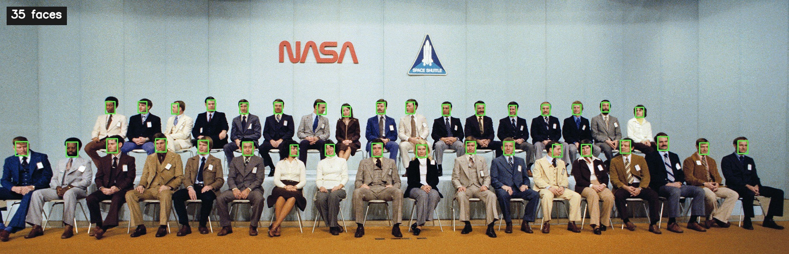

# Face Detection

Find every face in front of the camera, or in a photograph if there is no camera to hand.

A small Python program for a live webcam or a still image. It draws a box around each face, counts them, and, on a live camera, shows the frame rate.

[](https://www.python.org/)
[](https://opencv.org/)

## Demo



*NASA Astronaut Group 8, 1978 — a public-domain NASA photograph. The class has 35 members, and the program marks every face. The NASA wordmark and the shuttle patch are left alone.*

The picture above is a real run of this program:

```bash
python face_detect.py --image samples/nasa-astronaut-group-8.jpg --output docs/demo.jpg
```

## Features

- Live detection from the default webcam, or from another camera index
- A still-image mode, so the project can be tried with no camera and no display
- A face count on every result, and frames per second on the live view
- Quit with **Q**, **Esc**, or by closing the window
- A clear message, and a non-zero exit code, when the camera cannot be opened
- Detector weights included in the repository, so the first run does not download anything

## Installation

You need Python 3.10 or newer.

```bash
git clone https://github.com/Azhassin/Face-Detection.git
cd Face-Detection
python -m venv .venv
```

On macOS and Linux:

```bash
source .venv/bin/activate
```

On Windows:

```bash
.venv\Scripts\activate
```

Then install the pinned dependencies:

```bash
pip install -r requirements.txt
```

That installs NumPy and OpenCV, and nothing else. The OpenCV build includes the windowing code the live view needs.

## Usage

Open the webcam and detect faces until you quit:

```bash
python face_detect.py
```

If the camera you want is not index 0:

```bash
python face_detect.py --camera 1
```

Run on a photograph. Nothing is shown on screen; the annotated picture is saved next to the original, with `_detected` added to the file name.

```bash
python face_detect.py --image samples/nasa-astronaut-group-8.jpg
```

Choose where to write the result, and open a window as well:

```bash
python face_detect.py --image photo.jpg --output output/faces.jpg --show
```

Press **Q** or **Esc** to leave the live view, or close the window. **Ctrl+C** stops the program and releases the camera.

If no webcam is connected, the program says so and exits. The image command above is the way to try it on a machine without a camera.

## How it works

1. The program opens the webcam, or reads an image from disk.
2. [YuNet](https://github.com/opencv/opencv_zoo/tree/main/models/face_detection_yunet) returns a box for each face. It is a small neural-network detector, fast enough for a live preview on a normal laptop CPU. The weights are the ONNX file in `models/`, loaded from a path next to `face_detect.py`, so the working directory does not matter.
3. Photographs whose long side is over 1,920 pixels are scaled down for detection, and the boxes are mapped back onto the original. A tight, high-resolution portrait is tried once more at 960 pixels if the first pass finds nobody. YuNet was trained on faces of roughly 10 to 300 pixels, and a face that fills a large frame is easy to miss.
4. Each box is drawn in green. A label in the corner shows the count. In live mode that label also shows the frame rate, and a second label reminds you how to quit.

The confidence cut-off is `SCORE_THRESHOLD` at the top of `face_detect.py` (currently 0.8). Lower it if a real face is being skipped, and raise it if the background is being marked.

An earlier version of this repository also tried to estimate age, gender and emotion on every frame, with DeepFace and TensorFlow. Those libraries were never listed in a requirements file, so a clean checkout could not import the script, and a full analysis on every frame is too slow to sit inside a camera loop. This version does the part a live preview can sustain: finding faces. Age and expression, updated a few times a second rather than on every frame, are on the roadmap.

## Project structure

```
.
├── face_detect.py          # entry point
├── requirements.txt        # pinned NumPy and OpenCV versions
├── .gitignore
├── models/
│   ├── face_detection_yunet_2023mar.onnx
│   └── LICENSE             # MIT licence for the model weights
├── samples/
│   └── nasa-astronaut-group-8.jpg
└── docs/
    └── demo.jpg            # the annotated picture in the demo above
```

Annotated images you create yourself (`*_detected.jpg`, or anything under `output/`) are ignored by git.

## Roadmap

- Optional age and expression labels, refreshed a few times a second so the preview stays smooth
- A short automated check that the sample photograph still returns 35 faces
- Remembering the last camera index that opened successfully

## Credits

The sample photograph is [NASA Astronaut Group 8](https://commons.wikimedia.org/wiki/File:NASA_Astronaut_Group_8.jpg) (1978), a public-domain NASA image.

Face detection uses YuNet (March 2023) by Shiqi Yu and contributors, included under the MIT licence. See [`models/LICENSE`](models/LICENSE). If you use the model in published work, the authors ask to be cited:

> Wu, Peng and Yu, “Yunet: A tiny millisecond-level face detector”, *Machine Intelligence Research*, 2023.

This repository does not yet include a licence for the Python code itself.

## Author

**Mohammad Azhan Naseem**
Computer Science & AI student
GitHub: [@Azhassin](https://github.com/Azhassin)
